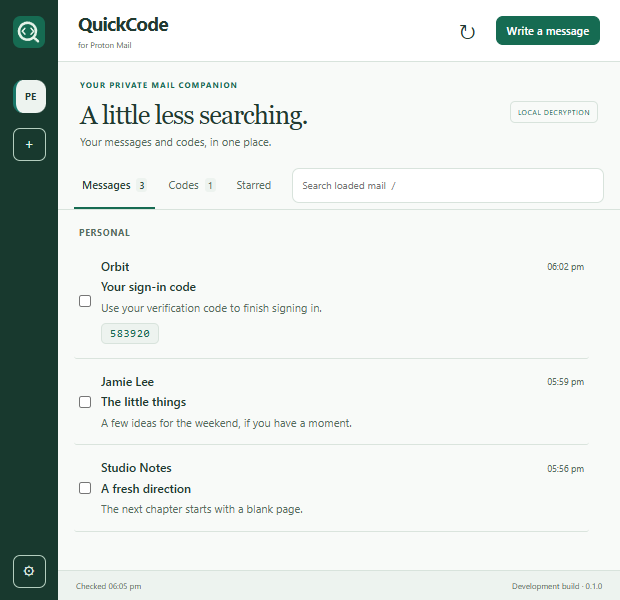
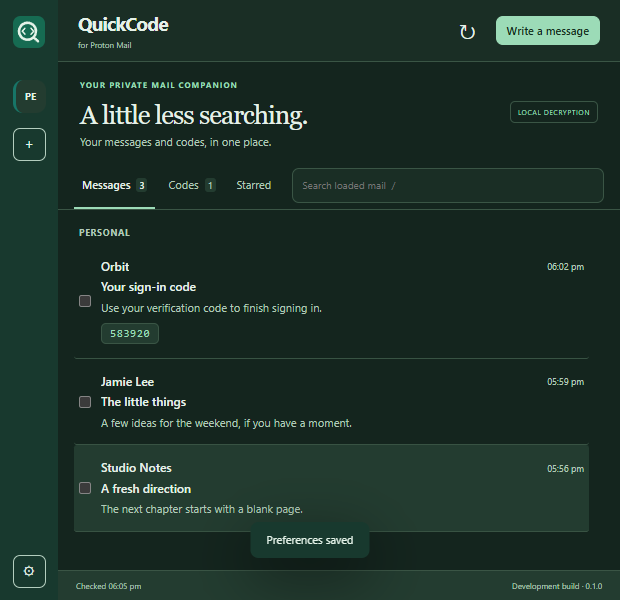

<p align="center"></p>
<h1 align="center">QuickCode for Proton Mail</h1>
<p align="center"><strong>Your messages and verification codes, in one place.</strong></p>
<p align="center">An original TypeScript browser-extension project by <a href="https://github.com/jahanaj098">jahanaj098</a>.</p>
<p align="center"><a href="#build-and-load">Build &amp; install</a> · <a href="docs/STATUS.md">Development status</a> · <a href="docs/PROVENANCE.md">Implementation record</a> · <a href="https://buymeacoffee.com/jahanaj098">Buy me a coffee ☕</a></p>

> **0.1.5 development build.** The standalone login, local cryptography and UI are newly implemented. Offline tests pass, but live Proton-account compatibility is not verified. Several planned integrations are still unfinished; see the status document before using this with an account.

## Built from a fresh starting point

No source files, generated bundles or Git history from the previous Mail Checker derivative were imported. Application modules, UI, icons and tests were written as new files. See [PROVENANCE.md](docs/PROVENANCE.md). Project timeline details are recorded in [HISTORY.md](docs/HISTORY.md).

Third-party libraries remain their authors' work. QuickCode uses Proton's published SRP/cryptography package, its OpenPGP.js fork, DOMPurify and other npm dependencies. The original application code is copyright **jahanaj098**, licensed under **GPL-3.0-only**; library licenses and credits are listed in [THIRD_PARTY.md](THIRD_PARTY.md).

## Workspace preview

| Light | Dark |
|---|---|
|  |  |

Screenshots use synthetic mail only.

## Current implementation

- **Standalone sign-in:** SRP server-proof verification, authenticator-code continuation and mailbox-password unlocking. A signed-in Proton tab is not the chosen architecture.
- **Local cryptography:** verified address-key tokens, local message/attachment decryption and encrypted compose-package construction.
- **Codes, ready to copy:** subject/body detection, numeric or mixed-character codes, separator normalization, ranking, up to three matches, custom patterns and per-account switches.
- **Private notification text:** sender, subject and codes only. DND and quiet-mail rules apply. Chrome gets copy/open actions; Firefox opens the message for code-chip copying.
- **A focused workspace:** account rail, Messages/Codes/Starred filters, loaded-mail search, multi-select, rich compose, reader and remote-image blocking.
- **Personal preferences:** three palettes, Light/Dark/Auto, density, dimensions, custom CSS, import/export and manual browser sync.

Mail operations and send options are experimental until tested against Proton's live API. Passkeys, Scribe, Drive links, calendar RSVP and several other features are not implemented. The [status document](docs/STATUS.md) separates implemented paths, offline validation and missing features.

## Build and load

Requires Node.js 24+ with npm and Git. Browser targets: Chrome 127+ or Firefox 142+.

```sh
git clone https://github.com/jahanaj098/QuickCode-for-Proton-Mail.git
cd QuickCode-for-Proton-Mail
npm ci
npm run typecheck
npm test
npm run notices
npm run build
```

### Chrome

Open `chrome://extensions`, enable **Developer mode**, select **Load unpacked**, and choose `dist/chrome`.

### Firefox

Open `about:debugging#/runtime/this-firefox`, choose **Load Temporary Add-on**, and select `dist/firefox/manifest.json`. Temporary installation lasts until Firefox closes. This project does not yet provide a Mozilla-signed package.

Sign-in opens a regular QuickCode tab. If Proton requests a CAPTCHA, a dedicated Proton verification tab opens; solve it there and keep the QuickCode tab open. The blocked request resumes once verification completes. Email/SMS-only challenges are not supported yet. See [verification flow](docs/HUMAN_VERIFICATION.md).

Use a separate browser profile and a test account for first validation. Enter credentials only into the extension UI. Do not post passwords, tokens or private keys in issues or chats.

## Account switching and email copying

The left sidebar starts on **All accounts** on first use, combining messages newest first. Later opens restore your last selected account. Select an account to filter its messages, then choose **All** to return. Account buttons show which account is selected. Each account has a **Copy** button beneath it for copying its email address; the selected account also has **Copy email** above its messages. Copying shows a confirmation toast and does not change the selected account.

## Background notifications and message list

Polling runs in the background while the browser is running; the toolbar popup can stay closed. Existing alarm deadlines are preserved across worker starts, and an overdue worker catches up on restoration. Browser sleep or OS notification settings can still delay alerts. The configured polling interval applies (60 seconds by default, minimum 30 seconds).

Notification Open and body clicks target the toolbar popup, with the selected message queued for its reader. If the browser blocks programmatic popup opening, click the QuickCode toolbar icon to read the queued message; no separate page is opened. Chrome 127+ provides the popup-opening API: [Chrome action documentation](https://developer.chrome.com/docs/extensions/reference/api/action#method-openPopup).

The list initially displays the newest five loaded unread messages. **More** reveals five additional loaded messages at a time. Search and account filters reset the display to five. The configured fetch limit still applies; this is not full mailbox history pagination. The toolbar badge separately uses Proton's full unread **Inbox** count for the selected account, or sums Inbox unread counts in All accounts. It is not capped by the loaded-message limit. Selection and counts survive closing the popup and worker restarts. Counts update at each background poll, not instantly when mail changes on another device. A failed/unavailable count shows **?**; zero unread clears the badge.

## Composer conveniences

Send confirmation appears inside QuickCode. Choose **Don't ask again on this device** to skip future send prompts; **Preferences > Reset confirmation alerts** restores them. The composer uses one scrolling surface with its Send button kept visible.

To, CC and BCC suggest email addresses from the selected account's latest 100 sent messages and successful QuickCode sends. Suggestions support comma-separated recipients. The local recipient cache is separate for each account and is removed when you disconnect it. Sent-message lookup failures do not prevent composing.

## Development

```text
src/core/        Own domain model, OTP detector, encoding and device vault
src/proton/      Own API, login, keyring and mailbox orchestration
src/background/  Own alarm, notification and runtime-message handlers
src/ui/          Own typed UI controller
public/          Own HTML, styles and vector mark
tests/           Offline cryptography, protocol-orchestration and policy tests
tools/           Browser builds, notices and synthetic UI checks
```

```sh
npm run typecheck
npm test
npm run build
node tools/check-ui.mjs
```

The UI check requires installed Microsoft Edge and Playwright. It uses synthetic mail, blocks non-local network requests and never signs in or sends mail. Screenshots are saved under `artifacts/ui`.

All 34 current tests pass. They exercise real local key/message/attachment encryption round trips, server-proof rejection, session-refresh serialization, notification redaction and worker-restart deduplication. They do **not** certify successful login or delivery through Proton's live service.

## Privacy boundaries

No telemetry, analytics or external license server is added. API calls are restricted to the Proton host declared in the manifests. Remembered sessions are encrypted on this device; session-only credentials are discarded when the browser session ends. Neither mode protects an account from someone who controls the browser profile.

Read messages use a sanitized, sandboxed frame with remote images blocked until explicitly allowed. Signatures and key transparency are not verified by the current reader. The toolbar badge uses full server Inbox unread totals; list counts describe the loaded messages. **Unsent compose drafts are not autosaved.**

## Support QuickCode

If you would like to support development, testing and maintenance:

<a href="https://buymeacoffee.com/jahanaj098"></a>

**[buymeacoffee.com/jahanaj098](https://buymeacoffee.com/jahanaj098)**

Support is optional and does not grant Proton-side entitlements or a guarantee that development features work.

## License and independence

Original QuickCode application code: Copyright (c) 2026 **jahanaj098**. [GPL-3.0-only](LICENSE). Third-party software retains separate notices in [THIRD_PARTY.md](THIRD_PARTY.md).

QuickCode is an independent project and is not affiliated with or endorsed by Proton AG. Proton and Proton Mail are trademarks of Proton AG. Proton's APIs, policies and account entitlements remain outside this project's control.
